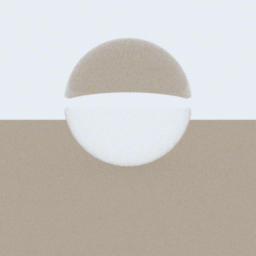

# T01 - Projectskelet, uv en Mitsuba-variant

**Oordeel: gehaald.** `uv run pytest` is groen (3 tests) en `uv run carbonne-smoke` rendert een glazen bol op een
vloer in spectrale modus en meldt de variant.

## Variant
`llvm_ad_spectral` (CPU). De GPU (Quadro P2000, Pascal, compute capability 6.1) is te oud voor Mitsuba 3.9, dat
minimaal 7.5 vraagt; `cuda_ad_spectral` kan dus niet. Details en tijden: `docs/queue/omgeving.md`.

## Zichtbare stap

Een glazen bol (BK7) op een bruine vloer onder een egale lichte hemel. De bol keert het beeld om, zoals een
glazen bol hoort te doen: onderin de bol zie je de lichte hemel, bovenin de vloer. Dat is bruikbaar als
eerste teken dat breking werkt; het is geen kwantitatieve controle.

## Getallen
- 256x256 @ 64 spp: 0.38 s; 512x512 @ 256 spp: 2.93 s (llvm_ad_spectral).
- Tests: variantkeuze, voorrang van `CARBONNE_VARIANT`, 64x64-render met eindig, niet-leeg beeld.

## Niet getest
Geen kwantitatieve fysicacontrole (volgt in latere taken); CUDA-pad niet uitvoerbaar op deze hardware;
`CARBONNE_VARIANT=scalar_spectral` alleen kort gerenderd, niet visueel bekeken.

## Beperkingen
De vloer is een eindige rechthoek (zichtbare rand aan de horizon); voor de rooktest geen probleem.
