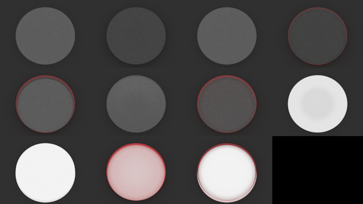

# T04 — Fysische validatie: bewijs

## Oordeel: deels gehaald
- **Analytische tests: gehaald.** Fresnel, kritische hoek en Beer-Lambert komen binnen tolerantie uit de renderer
  (`tests/test_physics.py`, 7 tests, 2 s).
- **A/B "zwart geverfd is niet gelijk aan een zwarte plaat": gereproduceerd.** De plaat met luchtspleet is
  1,9 keer lichter dan zwarte verf in contact.
- **A/B "zijkantkleur verspreidt sterker met luchtspleet": NIET gereproduceerd; het model geeft het omgekeerde.**
  De verwachting is niet aangepast. Mijn analyse van waarom en het voorstel staan in
  `docs/queue/vragen/T04-1.md` (de vraag ligt bij de gebruiker). De taak is dus inhoudelijk af, het
  afrondingscriterium voor dit ene effect is niet gehaald.

## Samenvatting voor niet-fysici
1. De renderer rekent de basisfysica van glas/epoxy correct: ongeveer 4,4 % van het licht kaatst terug op een
   glad vlak, licht dat van binnen te schuin op het oppervlak valt (vanaf ~41 graden) blijft gevangen, en
   absorptie in het materiaal neemt af zoals de natuurkundige formule voorschrijft.
2. Een zwart geverfde onderkant en een losse zwarte plaat eronder zien er verschillend uit: met een plaat zit er
   een glad glas/lucht-vlak tussen, dat zelf ~4 % licht terugkaatst; bij verf zit er niets tussen. Resultaat:
   bijna het dubbele aan licht in het midden van het tafeltje.
3. Rode verf op de zijkant kleurt het midden van het tafeltje in ons model alleen als de onderkant licht is
   en geverfd (contact). Met een plaat met luchtspleet blijft het midden neutraal. Dat is het omgekeerde van wat
   de aanname in het plan was; de verklaring (zie onder) is dat je bovenaf geen licht ziet dat in het glas
   gevangen zit, en dat we nog geen doorschijnende verf of verstrooiing modelleren. Dit moet de gebruiker beoordelen.

## 1. Analytische tests (`uv run pytest tests/test_physics.py`)
Eigen mini-scènes; vaste IOR 1,530; alle testwaarden gemeten, niet afgeleid van de code.

| test | verwacht | gemeten | tolerantie |
|---|---|---|---|
| Fresnel, loodrecht, een vlak (zwart erachter, 1024 spp) | ((n-1)/(n+1))^2 = 0,0438 | 0,0444 | +-0,005 (0,5 procentpunt) |
| Energiebehoud, plaat zonder absorptie, witte omgeving | 1,000 | binnen 0,01 | 0,01 |
| Transmissie binnen naar buiten bij 0 / 20 / 35 graden (eenstraals-BSDF, 20 000 monsters) | 1 - Fresnel (0,956 bij 0 graden) | 0,958 bij 0 graden | 0,01 |
| Kritische hoek arcsin(1/n) | 40,83 graden | transmissie 0,829 op 37,8 graden, 0,658 op 39,8, 0,458 op 40,5, 0,000 op 40,88 en hoger | exact 0 boven de hoek; 5 %-punt binnen 1 graad |
| Beer-Lambert sigma=20/m, d=2 cm (T incl. beide vlakken, incoherent) | 0,6752 | 0,6775 | 0,005 |
| Beer-Lambert sigma=50/m, d=2 cm | 0,3857 | 0,3876 | 0,005 |
| Beer-Lambert sigma=100/m, d=3 cm | 0,0894 | 0,0902 | 0,005 |
| Verhouding twee diktes, sigma=40/m, d=1 en 4 cm | e^(-sigma*dd) | binnen 3 % | 3 % |

Voor Beer-Lambert is de verwachte pixelwaarde (plaat in witte omgeving) T + R_totaal; beide met het incoherente
twee-vlakkenmodel. De absorptie is een homogeen medium met `sigma_t` in een `volpath`-integrator.

## 2. A/B-experiment (`uv run python scripts/ab_experiment.py --res 256 --spp 1024 --schaal 0.7`, ~3 minuten)
Opzet: vaste camera steil van boven (positie 0 / 0,75 / 0,2, doel op het bovenvlak, fov 40), constante witte
omgeving (radiantie 1), zwarte vloer (albedo 0,03), tafeltje 35 cm x 4 cm, zwart = albedo 0,03, rood =
(0,75 / 0,04 / 0,04), wit = 0,9. Zelfde zaad en 1024 spp voor alle varianten; elke variant met twee zaden
(3 en 11); in de tabel het gemiddelde, de kolom "ruis" is het halve verschil tussen de twee zaden.
Meetgebied (ROI) = vierkant van 31 x 31 pixels (+-0,06 beeldbreedte) in het midden van het bovenvlak (ongeveer
1/5 van de diameter, ver van de rand). Luminantie = Y (lineair, sRGB-primaries). x, y = CIE-chromaticiteit.
Neutraal grijs is x = 0,3127, y = 0,3290 en rood-aandeel R/(R+G+B) = 0,3333.

Beeld: `docs/evidence/img/T04-ab.png`, van linksboven naar rechtsonder: 0, A1, A2, B1 / B2, C, C-rood, W1 /
W2, WB1, WB2 (codes zie tabel).

| code | variant | R | G | B | luminantie | +- ruis | x | y | rood-aandeel |
|---|---|---|---|---|---|---|---|---|---|
| 0 | referentie: zijkant onbehandeld, onder onbehandeld | 0.1069 | 0.1069 | 0.1069 | 0.1069 | 0.0004 | 0.3127 | 0.3290 | 0.3333 |
| A1 | onder zwart geverfd, zijkant onbehandeld | 0.0564 | 0.0564 | 0.0564 | 0.0564 | 0.0001 | 0.3127 | 0.3289 | 0.3332 |
| A2 | zwarte plaat met luchtspleet, zijkant onbehandeld | 0.1069 | 0.1069 | 0.1069 | 0.1069 | 0.0004 | 0.3127 | 0.3290 | 0.3333 |
| B1 | onder zwart geverfd, zijkant rood | 0.0552 | 0.0549 | 0.0549 | 0.0549 | 0.0001 | 0.3130 | 0.3289 | 0.3345 |
| B2 | zwarte plaat met luchtspleet, zijkant rood | 0.1069 | 0.1068 | 0.1069 | 0.1069 | 0.0003 | 0.3127 | 0.3290 | 0.3333 |
| C | onder kleurloze matte lak (zwarte vloer), zijkant onbehandeld | 0.1029 | 0.1029 | 0.1029 | 0.1029 | 0.0004 | 0.3127 | 0.3290 | 0.3333 |
| C-rood | onder kleurloze matte lak (zwarte vloer), zijkant rood | 0.0897 | 0.0830 | 0.0831 | 0.0844 | 0.0003 | 0.3181 | 0.3289 | 0.3506 |
| W1 | onder wit geverfd, zijkant onbehandeld | 0.6973 | 0.6972 | 0.6968 | 0.6972 | 0.0003 | 0.3128 | 0.3291 | 0.3334 |
| W2 | witte plaat met luchtspleet, zijkant onbehandeld | 0.8925 | 0.8924 | 0.8917 | 0.8924 | 0.0003 | 0.3128 | 0.3291 | 0.3335 |
| WB1 | onder wit geverfd, zijkant rood | 0.6930 | 0.5551 | 0.5573 | 0.5846 | 0.0001 | 0.3288 | 0.3287 | 0.3839 |
| WB2 | witte plaat met luchtspleet, zijkant rood | 0.8916 | 0.8911 | 0.8904 | 0.8912 | 0.0003 | 0.3128 | 0.3291 | 0.3335 |

- Luminantie A2/A1 (plaat t.o.v. verf, zijkant onbehandeld): 1.895
- Luminantie B2/B1 (plaat t.o.v. verf, zijkant rood): 1.945
- Chromaticiteitsverschuiving door de rode zijkant, afstand in xy: verf B1 t.o.v. A1: 0.0003; plaat B2 t.o.v. A2: 0.0000
- Rood-aandeel R/(R+G+B): A1 0.3332, B1 0.3345, A2 0.3333, B2 0.3333
- Rood-aandeel langs het bovenvlak (ROI-midden 0 / 0,1 / 0,2 / 0,25 beeldbreedte van het midden; rand op ~0,32):
  - 0: [0.3333, 0.3336, 0.3331, 0.3334] (luminantie [0.1069, 0.1073, 0.1075, 0.1082])
  - A1: [0.3332, 0.3335, 0.3331, 0.3332] (luminantie [0.0564, 0.057, 0.0578, 0.058])
  - A2: [0.3333, 0.3336, 0.3331, 0.3335] (luminantie [0.1069, 0.1073, 0.1074, 0.108])
  - B1: [0.3345, 0.335, 0.3351, 0.3371] (luminantie [0.0549, 0.0552, 0.0552, 0.0547])
  - B2: [0.3333, 0.3336, 0.3332, 0.3367] (luminantie [0.1069, 0.1073, 0.1073, 0.1036])
  - C: [0.3333, 0.3336, 0.3332, 0.3334] (luminantie [0.1029, 0.1055, 0.1086, 0.1078])
  - C-rood: [0.3506, 0.3515, 0.3532, 0.3598] (luminantie [0.0844, 0.0847, 0.0845, 0.0818])
  - W1: [0.3334, 0.3333, 0.3334, 0.3335] (luminantie [0.6972, 0.6958, 0.7478, 0.7744])
  - W2: [0.3335, 0.3334, 0.3334, 0.3335] (luminantie [0.8924, 0.8925, 0.8929, 0.8927])
  - WB1: [0.3839, 0.3876, 0.4001, 0.417] (luminantie [0.5846, 0.5727, 0.5391, 0.4946])
  - WB2: [0.3335, 0.3335, 0.334, 0.3391] (luminantie [0.8912, 0.8906, 0.8821, 0.806])
- Matte lak (C) t.o.v. verf en plaat: luminantie A1 0.0564, C 0.1029, A2 0.1069

### Wat de getallen zeggen
- **A1 tegenover A2** (zijkant onbehandeld): luminantie 0,0564 tegenover 0,1069, een factor 1,9, ver boven de
  ruis (0,0001 - 0,0004). A2 is gelijk aan referentie 0 (onbehandeld, vloer op dezelfde diepte): de zwarte plaat
  verandert in het midden niets aan wat het glas zelf al geeft; de *verf* haalt juist de ~4 % terugkaatsing
  van het onderste glasvlak weg. Dat is het fysische verschil tussen verf in contact en een plaat met spleet.
  Met een witte onderkant is het nog groter (W1 0,70 tegenover W2 0,89).
- **Kleurverschuiving door de rode zijkant, midden bovenvlak, zwarte onderkant**: B1 (verf) verschuift
  0,0003 in xy, B2 (plaat) 0,0000. Beide zijn nul binnen de ruis. Met een zwarte onderkant is er te weinig
  licht in het blok om een kleurverschuiving te zien.
- **Zelfde meting met witte onderkant (aanvulling WB1/WB2)**: verf in contact (WB1) geeft een duidelijke
  roodverschuiving, rood-aandeel 0,384 (x = 0,329) in het midden en 0,417 bij de rand; de witte plaat met
  spleet (WB2) 0,3335 in het midden, 0,339 vlak bij de rand. Dat is het **omgekeerde** van de verwachting.
- **C (matte lak)**: luminantie 0,1029, tussen A1 (0,0564) en A2 (0,1069) zoals verwacht, maar dicht bij A2: een
  ruw vlak van alpha 0,3 laat nog bijna alle onder-licht in en uit. C-rood: rood-aandeel 0,3506 in het midden. De
  lak breekt de TIR gedeeltelijk, waardoor licht de zijkant wel bereikt (precies zoals plan §2.5 zegt).

### Waarom het model het omgekeerde van de verwachting geeft (hypothese, deels getest)
Een camera boven het blok ziet alleen licht dat het bovenvlak onder een hoek kleiner dan de kritische hoek
(~41 graden) raakt. Licht dat door totale interne reflectie wordt geleid, verlaat het bovenvlak dus nooit rechtstreeks;
het wordt alleen zichtbaar als iets het verstrooit. Een diffuse plaat onder een luchtspleet stuurt licht de epoxy
in binnen de kegel van 41 graden; dat raakt de zijkant van het blok (14 cm van het midden) nooit
(B2 en A2 zijn in het midden op 4 cijfers gelijk: er raakt geen pad de rode verf). Verf in contact straalt onder
alle hoeken de epoxy in; ~57 % daarvan zit gevangen en bereikt de rode zijkant, die het licht diffuus terug
verstrooit. Of de praktijkwaarneming van de gebruiker op doorschijnende verf of verstrooiing berust, kan het model nu
niet beantwoorden; dat is voorstel in `T04-1`.

## Gevonden en gecorrigeerd tijdens het werk
- Staat het blok onbehandeld of met lak op een vloer die precies op hoogte 0 ligt, dan lopen stralen door de vloer
  (ray-epsilon, zelfde oorzaak als T03) en zie je de witte omgeving erdoorheen: de "zwarte vloer" was wit. Het
  script zet de vloer daarom even diep als bij een plaat met spleet (`vloer_omlaag`). Een andere agent moet dit
  weten bij elke scène met een Bare/lak-onderkant boven een vloer (zie `docs/queue/omgeving.md`).

## Niet getest / beperkingen
- Geen vergelijking met foto's of metingen.
- Kritische hoek alleen op BSDF-niveau (eenstraals), niet met een render van een prisma.
- Beer-Lambert met een kunstmatig, kleurloos homogeen medium; geen gekleurde absorptie of vergeling getest.
- Het A/B-experiment is van boven bekeken, constante omgeving, een diameter en dikte. Kijkhoeken, HDRI en
  het randeffect zelf zijn niet doorgemeten; de rand (laatste ROI, 0,25 beeldbreedte) is wel in de tabel.
- Ruis: een zaadverschil van 2 zaden is een grove maat. Verschillen kleiner dan ~0,001 zijn niet betrouwbaar.
- De kleurverschuiving van B1 (0,0003) valt binnen de ruis; B1 rood-aandeel 0,3345 is wel significant hoger dan
  A1 (0,3332), maar klein.
