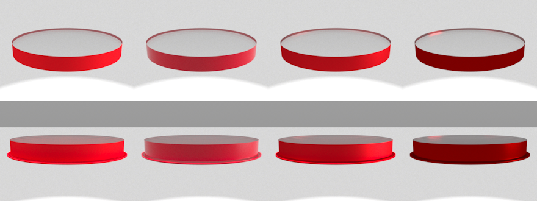

# T05 - Verftypes, kleurinvoer en vervolgmeting zijkant: bewijs

## Oordeel
- **Verftypes en kleurinvoer: gehaald.** matte, gloss, metallic en candy werken op zijkant, onderkant en plaat
  (12 rendertests, 33 tests in `tests/test_t05.py`, hele suite 82 geslaagd / 4 overgeslagen). Kleur via `#rrggbb`, `#rgb`
  of `RAL nnnn` (217 RAL Classic-codes).
- **Vervolgmeting zijkantkleur: gedaan; het lichtgeleider-effect volgt uit het model, maar is zwak en in
  de meeste kijkrichtingen kleiner dan bij verf in contact.** Het plan (§2.4) is niet aangepast; zie vraag
  `docs/queue/vragen/T05-1.md`.

## 1. Kleurinvoer
`core/kleur.py` (`parse_kleur`): hex of RAL naar lineair RGB (sRGB-decodering), want Mitsuba's `rgb` is lineair.
Ongeldige invoer geeft een `ValueError`. `Paint.color` en `PlateBelow.color` accepteren ook tekst. RAL-tabel:
`src/carbonne/data/ral_classic.csv`, bron Wikipedia "List of RAL colours" (sRGB-benadering, CC BY-SA, opgehaald
2026-10-11). **Benadering:** in spectrale modus maakt Mitsuba van RGB een glad spectrum; echte verf kan anders
reageren onder ander licht (metamerie). T12 kalibreert dat.

## 2. Verftypes (`core/scene.py: verf_bsdf`; binnen = epoxykant, buiten = luchtkant)
| soort | binnen (in contact met epoxy) | buiten (lucht) |
|---|---|---|
| matte | diffuus | diffuus |
| glossy (alias gloss) | diffuus pigment | `roughplastic`, GGX alpha 0,05, n 1,5 |
| metallic | `roughconductor`, gekleurde spiegelreflectie, alpha 0,25 | gelijk |
| candy | metalen ondergrond (standaard): `roughconductor`; witte ondergrond: diffuus | metalen: `roughconductor`; wit: `roughplastic` |

Candy-keuze: Mitsuba heeft geen gelaagd materiaal. De transparant gekleurde laag wordt benaderd door de ondergrond te
kleuren met transmissie^2 (licht gaat de laag in en weer uit; loodrecht, hoekafhankelijkheid van de weglengte
genegeerd). Bij metalen ondergrond is de ~4 % Fresnelreflectie van de lak weggelaten. Ruwheid is instelbaar (`roughness`),
de ondergrond via `candy_base`. In contact met de epoxy is er geen lak/lucht-grensvlak, dus geen glansreflectie aan
de binnenkant. Een plaat staat in lucht: beide zijden "buiten".

Tests (eenstraals-BSDF, geen render): gewichten kloppen met de kleur (metallic 0,6 bij kleur 0,6; candy 0,36 = 0,6^2;
gloss binnen = pigment 0,6); gloss en metallic hebben een spiegelpiek (> 3x matte) en ver ernaast niet; ruwer
metaal geeft een lagere piek.

Zichtbare stap: `docs/evidence/img/T05-verftypes.png`, dezelfde kleur (RAL 3020) in matte, gloss, metallic, candy; rij 1
op de zijkant (schuin boven), rij 2 op de zijkant en plaat (ooghoogte). Studio-omgeving met spot, 1024 spp, 3 s/beeld-cel.

Gezien: gloss is lichter/roze door reflectie van de omgeving over het pigment, metallic vlak met gespreide glans,
candy donkerder en dieper rood (kleur^2) met een felle spiegel van de spot. Alleen visuele indruk; geen kleurmeting.

## 3. Vervolgmeting: zijkantkleur gezien van de zijkant (vraag T04-1)
`scripts/zijkant_meting.py`, 512 px, 512 spp, 2 zaden, constante witte omgeving. Rode zijkant (0,75/0,04/0,04) en
referentie met onbehandelde zijkant; onderkant contact / plaat (spleet) / matte lak / onbehandeld; ondergrond zwart (0,03)
of wit (0,9). Camera 35 en 12 graden boven de horizon. Meetgebieden (7x7 px): mantel, bovenvlak 8 mm achter de voorrand
(`rand_voor`), midden, bovenvlak 8 mm voor de achterrand (`rand_achter`, je ziet daar de rode binnenkant van de mantel).
Ruis (halve verschil tussen zaden) in luminantie <= 0,004. Volledige tabel: `docs/evidence/T05-zijkant.json`
(ook met ruis per gebied); ROI-controlebeelden `img/T05-zijkant-*.png`.

Rood-aandeel R/(R+G+B), neutraal = 0,333. Rij "bare/plaat" wit en zwart zijn bij het midden identiek (plaat = onbehandeld
plus 4 % terugkaatsing).

| camera | onderkant, ondergrond | rand_voor (lum / rood) | midden | 
|---|---|---|---|
| 35 | contact, wit | 0,520 / **0,408** | 0,600 / **0,380** |
| 35 | plaat, wit | 0,858 / 0,336 | 0,897 / 0,333 |
| 35 | lak, wit | 0,525 / 0,360 | 0,510 / 0,365 |
| 35 | onbehandeld, wit | 0,845 / 0,337 | 0,896 / 0,334 |
| 35 | contact / plaat / onbehandeld, zwart | 0,334 / 0,334 / 0,334 | 0,334 / 0,334 / 0,334 |
| 35 | lak, zwart | 0,111 / 0,363 | 0,128 / 0,382 |
| 12 | contact, wit | 0,553 / **0,401** | 0,732 / 0,359 |
| 12 | plaat, wit | 0,779 / 0,353 | 0,938 / 0,334 |
| 12 | lak, wit | 0,522 / 0,400 | 0,625 / 0,355 |
| 12 | onbehandeld, wit | 0,793 / 0,367 | 0,937 / 0,334 |
| 12 | contact, zwart | 0,265 / 0,389 | 0,387 / 0,333 |
| 12 | plaat, zwart | 0,402 / 0,370 | 0,556 / 0,334 |
| 12 | lak, zwart | 0,308 / 0,392 | 0,419 / 0,347 |
| 12 | onbehandeld, zwart | 0,402 / 0,370 | 0,556 / 0,334 |

Bevindingen:
1. **Mantel**: rood-aandeel 0,90-0,91 overal; luminantie 0,10 (de verf zelf), alleen hoger (0,18) bij lak/onbehandeld op
   witte ondergrond (de witte vloer licht de rand aan: daar zie je de verf plus doorgelaten licht).
2. **Er is een lichtgeleider-effect**: bij ooghoogte (12 graden) kleurt de rand van het bovenvlak ook met plaat of onbehandeld
   (rood-aandeel 0,353 tot 0,370 bij `rand_voor`) terwijl de onbehandelde-zijkant-referentie 0,333 is. Dat is gevangen licht dat
   op de rode zijkant komt en vlak bij de rand onder een grote hoek naar buiten komt. Het is zwakker dan bij verf in
   contact (0,39 tot 0,40) en het verdwijnt naar het midden (0,334 bij plaat, 0,333-0,359 bij contact).
3. **Van boven (35 graden)** is er met plaat of onbehandeld geen verschuiving (0,333-0,337) en bij contact+wit wel (0,41 aan de
   rand, 0,38 in het midden): dezelfde bevinding als T04. Zwarte ondergrond + contact: geen verschuiving (er komt geen licht
   in het blok).
4. **Matte lak** zit er tussenin en kleurt als enige ook bij zwarte ondergrond (0,36-0,39), want de ruwe grensvlakken
   verstrooien licht naar de zijkant.
5. **De achterrand** (`rand_achter`) is rood door directe aanblik van de binnenkant van de mantel (rood-aandeel 0,42-0,69), geen
   lichtgeleiding.
6. **Wel zichtbaar**: de rode zijkant maakt het bovenvlak donkerder (plaat + wit, 12 graden: rand 0,78 tegen 0,93): de verf
   absorbeert het licht dat zonder rode zijkant (onbehandeld: TIR) rondgeleid zou worden.

Conclusie: de verwachting uit plan §2.4 ("kleur van de zijkant verspreidt zich over het hele vlak door lichtgeleiding bij een plaat")
volgt gedeeltelijk uit het model: een smalle kleurzoom langs de rand bij schuine blik, niet over het hele vlak, en bij verf in
contact sterker. Zonder doorschijnende verf of verstrooiing in het blok blijft het effect klein.

## Niet getest / beperkingen
- Geen vergelijking met een foto of echte verfspectra. Spectrale upsampling en metamerie niet onderzocht.
- Candy is een benadering (kleur^2, geen hoekafhankelijke weglengte, geen Fresnel van de lak op metaal).
- Gloss en metallic zijn alleen visueel en met eenstraalsgewichten beoordeeld, niet tegen een meetbare glanswaarde (GU).
- Doorschijnende verf en verstrooiing in de epoxy niet gemodelleerd (zie vraag T05-1).
- De meting gebruikt een constante omgeving; met HDRI of spot verschuiven de absolute waarden.
