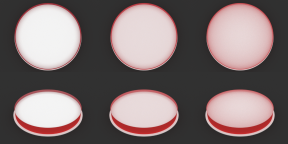

# T17 - Verstrooiing in de epoxy en ruw bovenvlak

## Oordeel

**Gehaald.** `EpoxyMaterial` heeft nu instelbare verstrooiing (`scattering_coeff` in 1/m, `scattering_g`) en een
werkende absorptie; `TableConfig` heeft `top_roughness`. Alles staat standaard op 0 en geeft dan hetzelfde beeld als
voor T17 (verschil met de oude code: 2e-7, ruisniveau van de floating point). Beer-Lambert klopt met het medium, en
energiebehoud (verstrooiing zonder absorptie verliest geen licht) is getest.

Wat de meting zegt, in gewone taal:

- **Een heel lichte verstrooiing in de epoxy is genoeg om gevangen zijkantkleur van boven zichtbaar te maken.** Bij
  een plaat met luchtspleet en een rode zijkant is het midden van het bovenvlak zonder verstrooiing neutraal wit
  (rood-aandeel 0,333). Vanaf **ongeveer 2 per meter** (de gemiddelde vrije weglengte is dan 50 cm, veel meer dan
  het blok groot is: een bijna helder blok) wordt het zichtbaar, bij 5 per meter is het duidelijk (0,364) en bij 5-20
  per meter bereikt de plaat ongeveer de kleurspreiding die verf in contact al zonder verstrooiing heeft (0,384).
- **Te veel verstrooiing werkt averechts.** Bij 100 per meter is het blok melkachtig; het licht verdwijnt dan al
  dichtbij waar het binnenkwam en het midden is weer neutraal (0,333).
- **Het effect heeft een prijs:** het blok wordt vager. Het midden van de plaat-met-spleet daalt van luminantie 0,89
  (helder, de witte plaat zie je er scherp doorheen) naar 0,72 bij 5 per meter. Het is dus "troebelheid die het
  zijkantlicht zichtbaar maakt", niet gratis kleurspreiding.
- **Een licht ruw bovenvlak (alpha 0,02-0,05) doet weinig:** midden 0,333 naar 0,337, achterrand 0,413 naar 0,427. Het
  verklaart de spreiding dus niet op zichzelf. Gecombineerd met verstrooiing voegt het niets toe.
- Dit blijft een **hypothese tot T12 (foto)**. Het model is een vereenvoudiging (homogeen medium, golflengte-
  onafhankelijke verstrooiing), geen gemeten materiaal. Plan §2.4 is niet gewijzigd.

## Zichtbare stap

`img/T17-verstrooiing.png`: rode zijkant, witte plaat met 0,1 mm luchtspleet. Kolommen van links naar rechts:
verstrooiing 0 (ideaal helder), 5 en 20 per meter. Bovenste rij: camera van boven (85 graden), onderste rij schuin
(35 graden). Links is de witte plaat scherp en neutraal zichtbaar met alleen een rode rand; rechts kleurt het hele
bovenvlak zacht roze, het sterkst langs de rand, en wordt de plaat vager. Gemaakt met 384x288 px, 1024 spp, twee
zaden, daarna 2x2 gemiddeld (kleiner bestand). De ROI-getallen van dit eindformaat komen overeen met die van de
lage resolutie (midden boven: 0,333 / 0,363 / 0,373 tegen 0,333 / 0,364 / 0,374).

## Wat er gebouwd is

- `core/config.py`: `EpoxyMaterial.scattering_coeff` (1/m, >= 0, standaard 0), `scattering_g` (-1..1, standaard 0 =
  isotroop, anders Henyey-Greenstein), `heeft_medium`; `TableConfig.top_roughness` (0..0,5, standaard 0).
- `core/scene.py`: `epoxy_medium(config)` bouwt een `homogeneous`-medium met spectrale `sigma_t` (= absorptie(lambda)
  + verstrooiing) en `albedo` (= verstrooiing / sigma_t) op de drie blokvlakken (`interior`); de absorptie die al in
  het model stond werkt nu dus ook. Met een medium kiest `build_scene` de `volpath`-integrator; zonder blijft het `path`.
  Bovenvlak met `top_roughness > 0` wordt een `roughdielectric` (GGX).
- `render/pipeline.py`: `integrator="path"` wordt `volpath` als de epoxy een medium heeft (`path` negeert media).
- `scripts/t17_meting.py`: de meetreeks; `tests/test_t17.py`: 10 tests.

## Metingen

Opstelling als in T05 (`scripts/zijkant_meting.py`): rode zijkant (0,75/0,04/0,04), blok 0,35 m x 4 cm, constante witte
omgeving, camera 85 graden (boven) en 35 graden (schuin), vier meetgebieden: `mantel` (de rode zijkant), `rand_voor` en
`rand_achter` (8 mm van de rand op het bovenvlak) en `midden`. Getal = rood-aandeel R/(R+G+B), neutraal = 0,333;
tussen haakjes luminantie. 128x96 px, 1024 spp, twee zaden, `max_depth` 200. Alle getallen:
`docs/evidence/T17-metingen.json`. Hieronder de belangrijkste (camera boven, midden van het bovenvlak):

| onderkant | s=0 | s=1 | s=2 | s=5 | s=20 | s=100 | s=20, g=0,7 | alpha 0,05 | s=20 + alpha 0,05 |
|---|---|---|---|---|---|---|---|---|---|
| plaat met spleet | 0,333 (0,89) | 0,340 (0,84) | 0,346 (0,80) | 0,364 (0,72) | 0,374 (0,70) | 0,333 (0,87) | 0,385 (0,65) | 0,337 (0,85) | 0,373 (0,69) |
| onbehandeld (zwarte vloer) | 0,334 (0,11) | 0,346 (0,11) | 0,358 (0,11) | 0,384 (0,13) | 0,365 (0,28) | 0,335 (0,63) | 0,396 (0,16) | 0,334 (0,11) | 0,362 (0,28) |
| verf in contact | 0,384 (0,59) | | | 0,383 (0,59) | 0,363 (0,66) | 0,335 (0,80) | 0,384 (0,59) | 0,383 (0,58) | 0,361 (0,65) |

Achterrand van het bovenvlak (camera boven, plaat met spleet): 0,413 (s=0), 0,434 (s=1), 0,481 (s=5), 0,526 (s=20).
Rand dus al bij 1 per meter merkbaar; midden pas vanaf ca. 2 per meter (+0,013) en duidelijk bij 5 (+0,031). Schuin
(35 graden) is het beeld gelijk: voorrand plaat 0,397 -> 0,441 (s=5) -> 0,506 (s=20); midden 0,334 -> 0,365 -> 0,374.

Verder:
- Verf in contact heeft al zijkantkleur in het midden (0,384) en wordt door verstrooiing juist neutraler (de extra
  verstrooiing verdunt de rode bijdrage); een plaat kan met verstrooiing dus dezelfde spreiding krijgen als contact.
- Asymmetrie g = 0,7 (voorwaarts verstrooiend) geeft meer kleurspreiding dan isotroop bij dezelfde coefficient
  (plaat midden 0,385 tegen 0,374 bij s=20): licht dat voorwaarts verstrooit blijft langer dichtbij de geleide richting.
- Bovenvlakruwheid alpha 0,05 verhoogt het rood-aandeel langs de achterrand van plaat (0,413 -> 0,427) en verlaagt de
  luminantie van het midden (0,89 -> 0,85) omdat de witte plaat dan minder scherp gezien wordt; kleine effecten.

### Renderduur en ruis

128x96, 1024 spp (twee zaden gemiddeld; 12 threads, gedeeld met andere agents, dus indicatief): zonder medium
(`path`) 2-3 s, met verstrooiing (`volpath`) 4-9 s per beeld (2-3x trager; meer bij hogere coefficient). De ruis per
meetgebied (verschil tussen twee zaden, RGB-waarde) is bij gelijke spp vergelijkbaar: 0,001-0,003, behalve bij 100 per
meter in het midden (0,006-0,045, trager convergerend omdat paden duizenden stappen blijven lopen). Aan 384x288
(figuur, 9x zoveel pixels): 54-72 s per beeld van boven en 18-41 s schuin.

### Valkuilen die de meting beinvloedden

- **`max_depth`**: elke verstrooiingsgebeurtenis telt als diepte. Bij 100 per meter geeft diepte 64 een veel te donker
  midden (luminantie 0,71 tegen 0,87 bij diepte 200); bij 5 per meter is er geen verschil. De pijplijnstandaard 32 is bij
  verstrooiing >= 20 per meter te laag; gebruik >= 128 (metingen: 200).
- Vloer en plaat zoals in T04/T05 (vloer lager dan de onderkant door ray-epsilon).

## Tests (`tests/test_t17.py`, 10 groen)

- Standaard (geen verstrooiing, geen ruwheid): geen medium, `path`-integrator, glad bovenvlak; en een volledige render
  van twee configuraties is gelijk aan die van de code vlak voor T17 (maximaal verschil 2e-7).
- Beer-Lambert via de spectrale absorptiecurve van `EpoxyMaterial` (sigma 50/m, d 2 cm): binnen 0,006 van de analytische
  waarde. (`tests/test_physics.py` doet hetzelfde met een los medium en blijft groen.)
- Energiebehoud: verstrooiing 150/m zonder absorptie (isotroop en g = 0,6) laat de pixel in een witte omgeving op
  1,00 +- 0,01; met absorptie wordt het < 0,97.
- Albedo per golflengte volgt uit absorptie en verstrooiing; medium op boven, mantel en onder.
- Inhoud (houtschijfjes) in een verstrooiende epoxy rendert eindig en wijkt af van zonder medium.
- Validatie van de nieuwe velden; de herkomst-integrator weigert een medium met een duidelijke foutmelding.

## Herkomst-integrator (T13) en medium

De T13-integrator volgt alleen oppervlakken en kent geen volumetransport; met een medium zou hij stilzwijgend
het licht in het blok verkeerd tellen. `render()` geeft daarom een `ValueError` zodra `integrator="herkomst"` wordt
gecombineerd met absorptie of verstrooiing in de epoxy. Zonder medium werkt hij ongewijzigd. Herkomst met
verstrooiing vraagt een uitbreiding van die integrator (een volpath-variant met bronbits); niet gedaan.

## Niet getest / beperkingen

- Alleen constante witte omgeving, geen HDRI en geen spot; geen vergelijking met een foto (T12).
- Verstrooiingscoefficient is golflengte-onafhankelijk (geen Rayleigh-achtige blauwdominantie); echte microbelletjes
  verstrooien vooral voorwaarts (g > 0) en deeltjes van enkele mu hebben een eigen golflengteafhankelijkheid.
- De waarden (1-100 per meter) zijn een schatting van wat "licht troebel" kan zijn; er is geen meting aan echte epoxy.
- Het medium zit op het hele blok, ook rond de inhoud; items hebben geen eigen medium en blijven in het medium van het
  blok. Een gietlaag met andere troebelheid is niet mogelijk.
- Het bovenvlak is alleen ruw als geheel; de zijkant en onderkant kunnen hun eigen (lak)ruwheid houden.
- Het onderzoek naar doorschijnende verf en een onregelmatige luchtspleet is buiten scope gelaten.
- De eindwaarden van de ROI's op 8 mm van de rand hangen af van de resolutie (de pixelgrootte bepaalt waar die 8 mm
  valt); vergelijk dus alleen binnen een resolutie.
