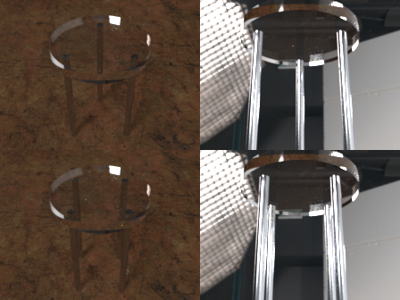
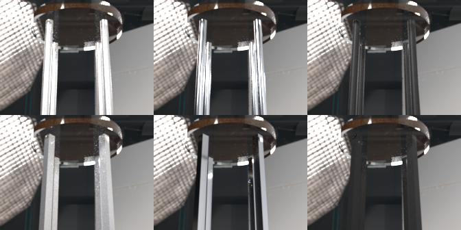

# T26 - Metalen poten onder het tafeltje

**Oordeel: voldaan.** Een tafeltje kan nu 3 tot 6 metalen poten krijgen (rond of vierkant, met maat, plaatsing,
lengte en metaalsoort). Ze staan in de render en in de preview, je ziet ze door de epoxy heen, de vloer ligt op de
pootlengte, en zonder poten is het beeld ongewijzigd.

## Beeld

Boven: tafeltje met 3 en met 4 poten, schuin van boven (links) en van onder (rechts), met gepoetst chroom in de
studio-omgeving. De bovenkant van elke poot is als donkere vlek door het epoxy te zien en de rand van de plaat
weerspiegelt de poten.

Onder: de drie metaalsoorten (geborsteld aluminium, gepoetst chroom, zwart gepoederlakt), rond (boven) en vierkant
(onder), van onder gezien.

Opnieuw maken: `uv run python scripts/render_t26.py --res 224 --spp 512 --out ... --metalen ...` (ca. 25 s).

## Wat is gebouwd

- `TableConfig.poten` (`Legs`): aantal 3..6, vorm rond/vierkant, afmeting 6..60 mm, afstand tot de rand 0..100 mm,
  lengte 0,05..0,8 m (standaard 0,41 m), metaal geborsteld/gepoetst/zwart. Standaard `None`: geen poten.
  Een combinatie die niet past (poten buiten het blok of in elkaar) geeft een duidelijke validatiefout.
- `core/poten.py`: geometrie (gesloten meshes met naar buiten wijzende normalen), metaalmaterialen, vloerhoogte.
- Scene: de vloer ligt op `ophangpunt - lengte`. Bij een plaat onder het blok hangen de poten onder de plaat.
- Cameravoorkeuzes houden dezelfde oogafstand boven de vloer (zittend/staand/kamer).
- Herkomst (T13): poten tellen als de bestaande categorie **vloer** (bit 8). Een nieuwe categorie zou het aantal
  categorieen en kanalen verdubbelen (16 naar 32, 55 naar ca. 110); dat is het niet waard. Je ziet dus in de
  herkomstkaart niet apart hoeveel licht via de poten komt.
- What-if (T15): parameters `poten.hoogte_m` en `poten.metaal`; bij gebruik worden de standaardpoten ingeschakeld.
- UI: sectie "Poten" (aantal 0 of 3-6, vorm, metaal, afmeting, afstand tot de rand, lengte). Standaard geen poten.
  De grenzen komen uit het schema (T27) en de contracttest bevat de poten.
- Preview (three.js): poten, lagere vloer, metaal- of lakmateriaal.

## Metingen en tests (`tests/test_t26.py`, 28 tests)

| Wat | Resultaat |
|---|---|
| Zonder poten: render t.o.v. basislijn van de code van voor T26 (constant en studio, 32x24, 16 spp) | gelijk binnen 1e-5 (verschil ca. 1e-6) |
| Aluminium en chroom: reflectie t.o.v. n en k uit de Mitsuba-tabellen, 450/550/650 nm | binnen 0,02; aluminium ca. 0,92, chroom ca. 0,65 |
| Zwart gepoederlakt: albedo | tussen 0,03 en 0,12 (lak ca. 4 % plus bijna zwart pigment) |
| Poten door de epoxy zichtbaar | het beeld verandert boven een poot minstens 5x zo sterk als op een poot-vrije plek |
| Geometrie | volume gesloten, normalen naar buiten, niet buiten het blok, niet rakend aan het blok |
| Vloer en oogafstand | vloer op de pootlengte; oog boven de vloer ongewijzigd |
| UI-contract | alle grenscombinaties (kleinste blok, alle vormen en metalen) geven geen 422 |
| Browser (Chrome) | poten kiezen toont 4 meshes, lengte verplaatst de vloer, 0 poten herstelt de vorige staat |

"Onveranderd zonder poten" is getest als `allclose` (rtol 1e-5), niet bit-voor-bit: Mitsuba levert tussen twee
runs verschillen in de laatste bit, ook met dezelfde zaad. De basislijn staat in `tests/data/t26_basis.npz`.

## Keuzes

- Een poot raakt het blok niet: de bovenkant ligt een haarspleet (`effectieve_gap_mm`) eronder, en de onderkant
  steekt 1 mm in de vloer. Zo valt er geen oppervlak samen met het grensvlak epoxy/lucht (float32-epsilon).
- Zwart gepoederlakt is geen blank metaal maar een poedercoating, dus gemodelleerd als ruwe plastic met bijna zwart
  pigment, niet als geleider.
- Bij een vierkante poot is de buitenste hoek de maat voor "afstand tot de rand". Bij een ronde poot is dat de
  buitenzijde.
- Bij een oneven aantal staat een poot achter (van de camera af), bij een even aantal staan ze diagonaal.

## Niet getest en beperkingen

- De preview is alleen met een nep-renderer en een browserscript gecontroleerd (aantal meshes, vloerhoogte,
  materiaal), niet met een visuele vergelijking met de render.
- Beelden zijn op lage resolutie (224 px per cel) gemaakt; er is geen volledige HQ-render op 960x540 gedaan.
- Poten zijn eenvoudige rechte staven: geen schuine poten, voetjes, dwarsverbindingen of montageplaten, en
  geborsteld metaal heeft geen richting in de ruwheid (isotrope GGX).
- Het zichtbare effect van de poten in het epoxy hangt sterk af van de omgeving; de poot onder het midden van de
  plaat (bij oneven aantal) is vaak nauwelijks te zien vanwege de ruwheid van de onderkant.
- De herkomstkaart rekent de poten onder "vloer" (zie boven).
- Het is niet bepaald waarom een eerdere pytest-run eenmaal ruim 2 minuten op 100 % CPU bleef hangen; herhalen
  gaf geen probleem.
